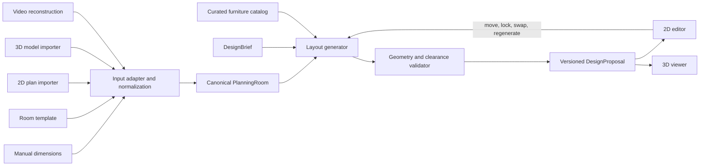
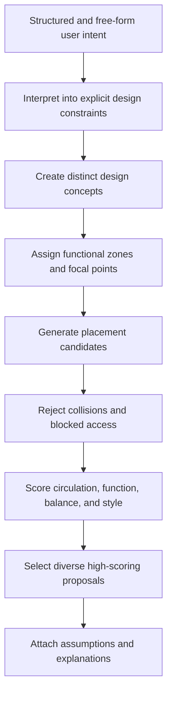
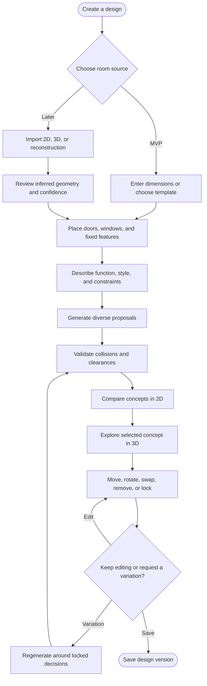
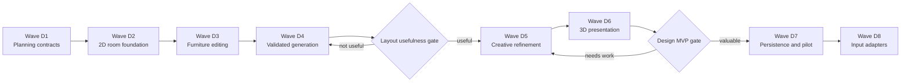

# Design-first MVP development plan

Status: proposed for review

This document defines the primary MVP for Room Planner. The product must first
prove that a user can turn known room geometry into useful, creative, editable
furniture layouts. Video reconstruction remains a supported future way to
create that geometry, but it is not a prerequisite for design development.

## 1. MVP outcome

A pilot user can:

1. Start from a simple room template or enter measured room dimensions.
2. Add doors, windows, and fixed features.
3. Describe how the room should function and feel.
4. Generate at least three materially different furniture layouts.
5. Understand why each layout works and see any uncertainty or constraint
   warnings.
6. Explore the same layout in 2D and 3D.
7. Move, rotate, remove, replace, and lock furniture.
8. Ask for a variation without losing locked decisions.
9. Save and compare design versions.

The MVP is a design exploration tool, not a guarantee that a product fits.
Physical dimensions are stored in meters. A proposal must not claim safe fit
when room geometry, product dimensions, or required clearance is uncertain.

## 2. Product boundary

The first end-to-end slice supports rectangular rooms with manually entered
dimensions, doors, and windows. A small curated catalog contains representative
furniture with real dimensions and design metadata. This deliberately tests
the design experience before adding difficult input adapters or retailer data.

### Included in the MVP

- Manual creation of a measured room.
- A canonical metric planning-room model.
- Furniture footprints, dimensions, functions, and style attributes.
- Structured design preferences and optional free-form direction.
- Multiple deterministic, reproducible layout alternatives.
- Hard collision checks and visible clearance guidance.
- Direct manipulation in 2D.
- A synchronized 3D presentation view.
- Design version comparison and refinement.

### Deferred until the core loop works

- Automatic extraction from arbitrary plan images, PDFs, CAD, or BIM files.
- Video reconstruction as the required onboarding path.
- Photorealistic rendering.
- A complete retailer catalog, live inventory, prices, or checkout.
- Renovation, structural, accessibility, or code-compliance claims.
- Guaranteed placement based on inferred or incomplete geometry.

## 3. Canonical architecture

Every input adapter produces the same `PlanningRoom`. Design generation and
rendering never depend directly on reconstruction output, an uploaded image, or
a vendor-specific 3D format.

The existing reconstruction `RoomModel` remains evidence produced by a worker.
It can later be calibrated and converted into a `PlanningRoom`; the two models
must not be conflated.

## 4. Core data responsibilities

### PlanningRoom

- Metric floor boundary and wall height.
- Doors, windows, openings, and fixed obstacles.
- Source of each dimension: user measurement, imported, derived, or inferred.
- Confidence and user-validation state for uncertain geometry.
- Safe editable zones and unknown regions.

### FurnitureItem

- Width, depth, and height in meters.
- Functional category and supported room roles.
- Front, back, access, and circulation clearances.
- Style, material, color, and visual-weight tags.
- Provenance for dimensions and catalog metadata.
- Optional source product identifier without implying current availability.

### DesignBrief

- Room activities and priority order.
- Required, optional, excluded, and retained items.
- Seating, storage, work, sleep, and accessibility needs.
- Style, palette, material, and mood preferences.
- Budget band and willingness to replace existing items.
- Free-form direction plus the structured interpretation shown to the user.

### DesignProposal

- Exact catalog item and transform for every placement.
- Generator version, seed, brief version, and room version.
- Hard-constraint results and soft-quality scores.
- Assumptions, warnings, and explanation.
- Locked user decisions and parent proposal when regenerated.

## 5. Generation strategy

Creativity and physical validity are separate responsibilities.

The initial generator should be deterministic and testable. An AI model may
later interpret free-form language or suggest creative concepts, but it must
not override geometry validation or silently invent measurements. Unsupported
or ambiguous input becomes a visible assumption or a clarification request.

Alternative proposals must differ in meaningful ways, such as focal point,
conversation arrangement, work zone, or circulation strategy. Merely changing
colors or shifting the same furniture a few centimeters is not a new layout.

## 6. User workflow

## 7. Development order

Work is organized around vertical capabilities. Each PR should prefer 200 to
300 human-authored lines and remain below 500 where practical. A stack is used
only when a later PR directly imports code from the earlier PR.

### Wave D1: canonical design contracts

| Work item | Scope                                 | Completion condition                                                    |
| --------- | ------------------------------------- | ----------------------------------------------------------------------- |
| D1.1      | Planning room and geometry primitives | Metric boundaries and openings preserve provenance and confidence       |
| D1.2      | Furniture and clearance contracts     | Invalid dimensions, orientation, and clearance data are rejected        |
| D1.3      | Design brief contract                 | User needs and interpreted assumptions are explicit                     |
| D1.4      | Proposal and placement contracts      | A proposal is reproducible, attributable, and independently validatable |
| D1.5      | Synthetic room and catalog fixtures   | Later UI and engine tests share safe, deterministic examples            |

D1.1 through D1.4 form a small stack because later contracts import earlier
geometry and identity primitives. Fixtures may be independent once the schemas
merge.

### Wave D2: room creation and 2D foundation

| Work item | Scope                              | Completion condition                                               |
| --------- | ---------------------------------- | ------------------------------------------------------------------ |
| D2.1      | World-to-screen transform and grid | Metric geometry renders consistently at different viewport sizes   |
| D2.2      | Rectangular room entry             | A user can enter dimensions with unit conversion at the input edge |
| D2.3      | Doors, windows, and fixed features | Openings render with swing and obstruction zones                   |
| D2.4      | Room review and confidence UI      | Inferred and user-validated geometry are visually distinct         |

This wave produces a useful floor-plan surface before furniture or generative
features complicate interaction testing.

### Wave D3: furniture catalog and direct editing

| Work item | Scope                           | Completion condition                                         |
| --------- | ------------------------------- | ------------------------------------------------------------ |
| D3.1      | Curated starter catalog         | Living-room fixtures have tested dimensions and metadata     |
| D3.2      | Furniture footprint renderer    | Items show orientation, footprint, and required access zones |
| D3.3      | Selection, move, and rotation   | Keyboard, pointer, and touch edits update metric transforms  |
| D3.4      | Collision and boundary feedback | Invalid placement is prevented or explicitly marked          |
| D3.5      | Undo, redo, and local draft     | Editing is reversible and survives a refresh on one device   |

The first catalog should use representative furniture rather than live retail
products. This isolates spatial and design quality from vendor-data quality.

### Wave D4: deterministic layout generation

| Work item | Scope                        | Completion condition                                                       |
| --------- | ---------------------------- | -------------------------------------------------------------------------- |
| D4.1      | Functional zones and anchors | Doors, windows, focal points, and activity zones constrain candidates      |
| D4.2      | Placement candidate engine   | Seeded generation produces reproducible candidates                         |
| D4.3      | Hard constraint validator    | Collisions, boundary violations, and blocked openings cannot pass silently |
| D4.4      | Soft scoring                 | Circulation, conversation distance, balance, and function are inspectable  |
| D4.5      | Diverse proposal selection   | At least three materially different valid concepts are returned            |

After D4, test whether generated layouts are useful before adding AI services,
photorealism, broad catalogs, or complex importers.

### Wave D5: creative direction and refinement

| Work item | Scope                                | Completion condition                                                        |
| --------- | ------------------------------------ | --------------------------------------------------------------------------- |
| D5.1      | Style vocabulary and design recipes  | Supported styles map to explicit palettes, materials, and composition rules |
| D5.2      | Design brief interface               | Structured needs and optional free-form direction can be reviewed           |
| D5.3      | Lock and regenerate                  | Variations preserve every locked item and user edit                         |
| D5.4      | Swap and alternatives                | Replacements preserve function and re-run spatial validation                |
| D5.5      | Natural-language interpreter adapter | Free-form input becomes visible structured intent with a non-AI fallback    |

The interpreter is replaceable. The rest of the application consumes only the
validated `DesignBrief`, so layout behavior does not depend on one model vendor.

### Wave D6: synchronized 3D presentation

| Work item | Scope                          | Completion condition                                                   |
| --------- | ------------------------------ | ---------------------------------------------------------------------- |
| D6.1      | Room shell scene               | The canonical room renders at metric scale with stable camera controls |
| D6.2      | Furniture proxy geometry       | Every 2D placement has a dimensionally consistent 3D representation    |
| D6.3      | Materials, lighting, and style | Concepts are visually distinguishable without claiming photorealism    |
| D6.4      | 2D and 3D synchronization      | Selecting or editing in either view references the same proposal state |

3D follows validated 2D placement so presentation concerns cannot hide layout
errors. Imported decorative models remain optional assets, not source data.

### Wave D7: persistence and pilot readiness

| Work item | Scope                           | Completion condition                                            |
| --------- | ------------------------------- | --------------------------------------------------------------- |
| D7.1      | Authentication and ownership    | Only the owner can access a project and its designs             |
| D7.2      | Room and proposal persistence   | Saved versions retain generator and provenance metadata         |
| D7.3      | Compare, duplicate, and archive | Users can experiment without overwriting a preferred design     |
| D7.4      | Private pilot operations        | Deletion, error handling, and bounded service usage are visible |

### Wave D8: additional floor-plan inputs

| Work item | Scope                  | Completion condition                                                       |
| --------- | ---------------------- | -------------------------------------------------------------------------- |
| D8.1      | Structured 2D import   | A documented interchange format normalizes into `PlanningRoom`             |
| D8.2      | Image or PDF tracing   | Extracted geometry requires user review before design use                  |
| D8.3      | 3D import adapter      | Supported geometry is reduced to planning surfaces and openings            |
| D8.4      | Reconstruction adapter | A calibrated reconstruction becomes an uncertain, reviewable planning room |

Input adapters are prioritized using pilot demand. Each adapter must preserve
source provenance and must not upgrade inferred geometry to measured geometry.

## 8. Immediate PR sequence

The next implementation work after this plan is accepted should be:

1. **D1.1:** planning-room geometry primitives and tests.
2. **D1.2:** furniture dimensions and clearance contracts.
3. **D1.3:** structured design-brief contract.
4. **D1.4:** proposal, placement, validation-result, and version contracts.
5. **D1.5:** one rectangular living room and a small synthetic furniture set.
6. **D2.1:** metric 2D transform and a read-only room renderer.

Do not begin authentication, cloud persistence, AI integration, 3D assets, or
new reconstruction infrastructure before the first read-only 2D room renders
from the shared contracts. This order creates a visible vertical slice early
and keeps expensive or vendor-specific decisions reversible.

## 9. Test strategy

### Automated tests

- Runtime validation for every persisted and exchanged contract.
- Property tests for metric transforms and placement bounds.
- Generated rectangular and irregular rooms with no customer data.
- Collision, opening, clearance, and circulation edge cases.
- Seeded generation snapshots based on semantic placements, not pixels.
- Tests proving locked items do not move during regeneration.
- Tests proving uncertain geometry cannot produce an unconditional fit claim.
- Browser interaction tests for touch, pointer, keyboard, undo, and view sync.

### Human design evaluation

- Compare concepts without knowing which algorithm produced them.
- Rate usefulness, distinctness, aesthetics, and ease of refinement separately.
- Record whether a user keeps, edits, or discards each generated concept.
- Test small, awkward, and incomplete rooms rather than only ideal rectangles.
- Verify real clearances independently before making placement-readiness claims.

## 10. Decision gates

### Layout usefulness gate after D4

- At least three proposals are valid or clearly disclose unresolved geometry.
- Proposals are meaningfully different in spatial strategy.
- Users identify at least one proposal worth refining in most pilot sessions.
- Hard geometry failures are detected rather than hidden by presentation.
- The same seed, room, catalog, and brief reproduce the same proposal.

If this gate fails, improve the room model, catalog metadata, rules, or scoring
before adding language models or 3D presentation.

### Design MVP gate after D6

- Users can reach a preferred design through generation and direct editing.
- Locked choices survive requested variations.
- 2D and 3D remain spatially consistent.
- Users understand assumptions, warnings, and the difference between measured
  and inferred geometry.
- The 3D view materially improves evaluation rather than merely looking novel.

## 11. Product safety and privacy rules

- Store physical dimensions in meters and convert only at UI boundaries.
- Preserve geometry, measurement, and catalog provenance.
- Treat imported and reconstructed geometry as inferred until validated.
- Never claim a product fits when clearance or geometry is uncertain.
- Keep projects, uploads, generated designs, and preference data private by
  default.
- Do not send room geometry or user text to an AI provider without clear
  disclosure and an approved data-handling path.
- Keep the deterministic validator authoritative regardless of how a concept
  was generated.

## 12. Initial product decisions

The development order assumes:

1. The first supported room type is a rectangular living room.
2. The initial catalog contains representative, dimensioned furniture rather
   than live retailer inventory.
3. The first generator runs locally and deterministically from seeded rules.
4. The first 3D view uses dimensionally correct proxy geometry.
5. Natural-language interpretation is optional until structured controls and
   layout generation work end to end.
6. Additional room types and input adapters follow evidence from the pilot.

Changing one of these assumptions may reorder work and should be recorded in
`docs/` before implementation diverges from this plan.
