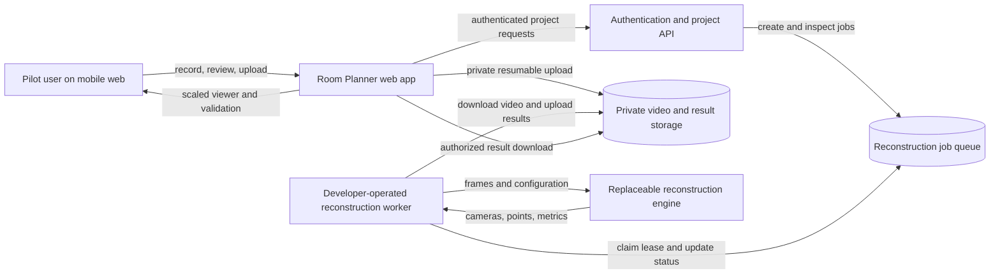
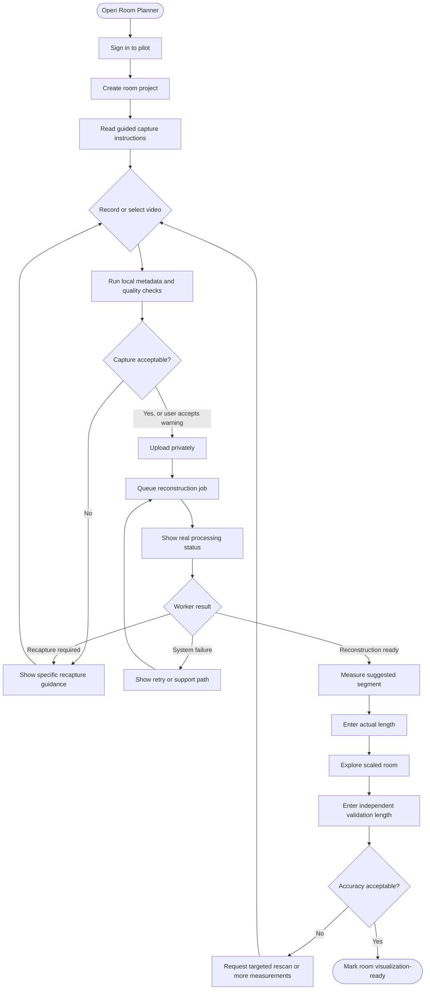
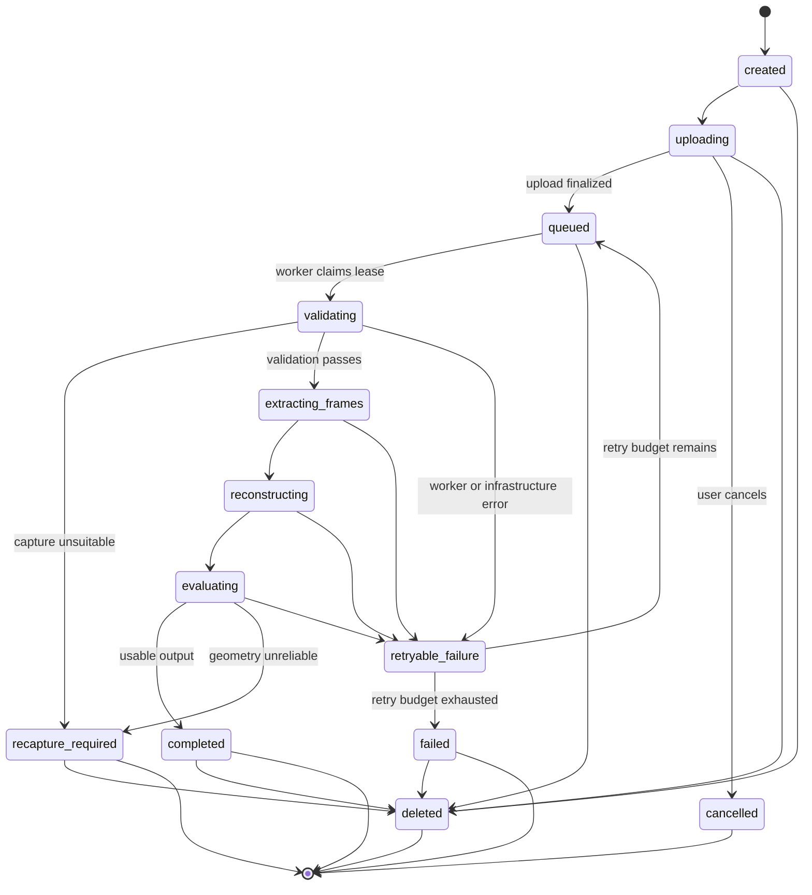
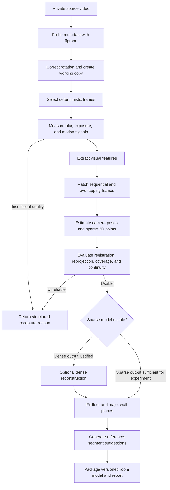

# Reconstruction development plan

Status: proposed for review

This document defines the first user-facing implementation phase of Room
Planner. Its purpose is to determine whether ordinary phone video can produce
room geometry that is useful for visualization and approximate furniture
planning, without requiring users to run developer commands.

## 1. Phase outcome

A pilot user can:

1. Sign in and create a room project.
2. Record or select a room video on a phone.
3. Receive immediate capture-quality feedback.
4. Upload the video to private storage.
5. Follow real reconstruction progress.
6. Receive either an inspectable reconstruction or an actionable recapture
   request.
7. Enter one known length to scale the reconstruction.
8. Inspect the scaled room and verify a second independent measurement.

The initial result does not need to be photorealistic. It must preserve
measurement provenance, expose uncertainty, and fail honestly when the video
does not support a trustworthy reconstruction.

## 2. System context

The reconstruction worker can initially run on developer-owned hardware. It
connects outward to the backend and is never exposed directly to the internet.
If the worker is unavailable, jobs remain queued and the user sees that state.

## 3. User workflow

The user never invokes FFmpeg, COLMAP, Python, or command-line tools.

## 4. Job lifecycle

State transitions are enforced by the backend. Workers use time-limited leases
so abandoned jobs can be recovered without running the same job concurrently.
Every retry records its attempt number and pipeline version.

## 5. Reconstruction pipeline

COLMAP is the initial baseline, not a permanent architectural dependency. The
worker calls it through an engine adapter so another implementation can be
benchmarked without changing job contracts or the frontend.

## 6. Versioned outputs

The worker produces immutable, versioned artifacts for each attempt:

- `capture-report.json`: video metadata and capture-quality findings.
- `frame-manifest.json`: selected frame identifiers and timestamps.
- `reconstruction-report.json`: processing metrics and failure categories.
- `room-model.json`: cameras, points, inferred surfaces, and confidence.
- Optimized viewer assets when a result is usable.

The room model distinguishes:

- Observed reconstruction data.
- Geometry inferred from observed data.
- Measurements entered by a user.
- Measurements derived after scale calibration.
- Geometry or measurements explicitly validated by a user.

Physical dimensions are stored in meters. Units are converted only when users
enter or view a value.

## 7. Implementation waves

Related changes are delivered in waves. Pull requests within a wave may be
stacked when a later slice directly imports the earlier slice. Each PR should
prefer 200 to 300 human-authored lines, remain below 500 where practical, and
leave the repository in a testable state.

### Wave 1: versioned contracts

| Work item | Scope                                | Completion condition                                   |
| --------- | ------------------------------------ | ------------------------------------------------------ |
| W1.1      | Contract package and primitives      | Shared runtime validation runs in repository CI        |
| W1.2      | Project and capture contracts        | Invalid ownership, media, and assessments are rejected |
| W1.3      | Reconstruction job lifecycle         | Leases, retries, failures, and transitions are tested  |
| W1.4      | Reconstruction report contracts      | Metrics and artifacts cannot claim false usability     |
| W1.5      | Room-model and calibration contracts | Coordinates preserve confidence and provenance         |

Wave 1 is stacked because every contract slice imports the shared primitives.

### Wave 2: mobile capture

| Work item | Scope                             | Completion condition                                            |
| --------- | --------------------------------- | --------------------------------------------------------------- |
| W2.1      | Video selection and local preview | A user can select, inspect, replace, and cancel a video         |
| W2.2      | Mobile camera recording           | Supported phones can record with explicit permission UX         |
| W2.3      | Metadata validation               | Unsupported size, duration, format, and resolution fail clearly |
| W2.4      | Sampled quality signals           | Blur, darkness, and motion warnings produce capture reports     |

Selection and recording are separated so browser permission behavior does not
obscure the basic file lifecycle during review.

### Wave 3: private submission

| Work item | Scope                             | Completion condition                                   |
| --------- | --------------------------------- | ------------------------------------------------------ |
| W3.1      | Backend configuration and login   | Invite-only users can establish authenticated sessions |
| W3.2      | Project persistence and policies  | Users cannot access projects owned by another user     |
| W3.3      | Private resumable uploads         | Uploads support progress, cancel, retry, and deletion  |
| W3.4      | Job creation and status interface | Real backend states appear without simulated progress  |

### Wave 4: reconstruction worker

| Work item | Scope                              | Completion condition                                    |
| --------- | ---------------------------------- | ------------------------------------------------------- |
| W4.1      | Python worker package and CI       | Python formatting, linting, typing, and tests run in CI |
| W4.2      | Leasing and retry behavior         | Abandoned jobs recover without concurrent processing    |
| W4.3      | Video probing                      | Source metadata becomes a versioned capture report      |
| W4.4      | Deterministic frame extraction     | Synthetic video produces a reproducible frame manifest  |
| W4.5      | Reconstruction engine adapter      | The initial COLMAP baseline is replaceable and tested   |
| W4.6      | Quality evaluation and persistence | Unreliable output becomes an actionable failure         |

### Wave 5: calibration and feasibility decision

| Work item | Scope                         | Completion condition                                    |
| --------- | ----------------------------- | ------------------------------------------------------- |
| W5.1      | Authorized result delivery    | Only the project owner can retrieve reconstruction data |
| W5.2      | Reference selection interface | A user can identify a well-observed segment             |
| W5.3      | Metric calibration            | One known length scales the model with provenance       |
| W5.4      | Diagnostic 3D viewer          | Cameras, points, surfaces, and confidence are visible   |
| W5.5      | Benchmark and decision report | The consented dataset produces reproducible results     |

Waves 1 through 4 produce the real user-facing submission and processing path.
Wave 5 determines whether reconstruction is reliable enough to invest in the
furnishing portion of the MVP.

## 8. Test strategy

### Repository-safe automated tests

- Synthetic videos generated during tests.
- Small generated images with known motion and geometry.
- Contract fixtures containing no customer data.
- Unit tests for state transitions, leases, retries, scaling, and unit
  conversion.
- Command-construction and result-parsing tests for the engine adapter.
- Browser tests for capture denial, replacement, upload retry, and job failure.
- Access-control tests proving projects and media cannot cross user boundaries.

### Real-device and real-room tests

- Physical iPhone and Android capture where available.
- Interrupted uploads and weak-network behavior.
- Worker shutdown during each processing stage.
- Blank walls, mirrors, windows, low light, and partial occlusion.
- Independent measurements that are not used for calibration.

Real videos, extracted frames, point clouds, and meshes remain outside Git and
CI. Only consented aggregate metrics and non-identifying summaries may be
committed.

## 9. Feasibility dataset

Collect approximately 15 to 20 consented videos across:

- Living rooms and bedrooms.
- Empty and furnished rooms.
- Simple rectangular and mildly irregular spaces.
- Textured and largely blank walls.
- Mirrors, windows, and reflective surfaces.
- Good and mediocre lighting.
- Good guided captures and intentionally poor captures.
- Multiple supported phone models where practical.

Each room needs at least two independently measured segments:

1. One long, clearly identified segment for calibration.
2. One or more withheld segments for accuracy evaluation.

## 10. Decision gate

The following are provisional engineering targets, not customer-facing accuracy
claims:

- At least 80% of guided captures produce coherent reconstruction.
- Failed captures are detected rather than presented as trustworthy geometry.
- At least 70% of selected frames register on successful captures.
- Median relative error on withheld room-scale measurements is approximately 5%
  or better.
- Processing time is acceptable for an invite-only asynchronous pilot.
- Recapture messages identify an action the user can reasonably take.
- Intermediate artifacts are deleted according to the retention policy.

Results are classified as:

- `visualization_ready`: adequate for approximate layouts and presentation.
- `placement_ready`: meets stricter absolute clearance tolerances.
- `recapture_required`: evidence is insufficient or internally inconsistent.

If the baseline misses the gate, evaluate guided rescanning, additional
reference measurements, device motion data, ARKit/ARCore capture, LiDAR support,
or a semi-manual floor-plan workflow before building furnishing features.

## 11. Privacy and operational requirements

- Videos and outputs are private by default.
- Storage access is scoped to the owning user and project.
- Worker credentials have the minimum required access.
- Logs contain identifiers and metrics, not image contents or signed URLs.
- Downloads use short-lived authorization.
- Users can delete source media and generated results.
- Retention periods are visible before upload.
- Temporary worker files are removed after completion or failure.
- Expensive retries and concurrent jobs are bounded.

## 12. Out of scope for this phase

- Photorealistic room reproduction.
- Exact reconstruction of every existing object.
- Furniture recognition or removal.
- Furnished layout generation.
- Product catalog and shopping links.
- Camera-pan rendering or video export.
- Renovation-grade measurement claims.
- Unrestricted public processing.
- Permanent cloud GPU infrastructure.

## 13. Review decisions

Before implementation begins, confirm:

1. Supabase remains the initial authentication, database, and private-storage
   provider.
2. The pilot authentication method and invite policy.
3. The worker machine's operating system, CPU, GPU, memory, and availability.
4. The initial upload-size and duration limits.
5. The source-video and reconstruction retention periods.
6. Whether approximate visualization is valuable if placement-ready accuracy is
   not reached.
7. Which phone models are available for the benchmark dataset.
